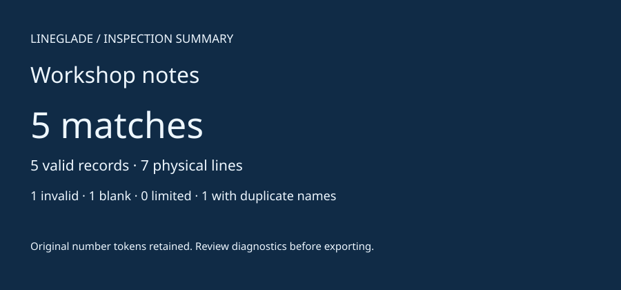

# Lineglade

A little room for every record.

Lineglade is a local, read-only JSONL / NDJSON inspector. Compare wrapped fields, filter a nested value, inspect malformed lines, and download matching records without rounding large numbers.

- **Readable comparisons:** 1–6 JSON Pointer columns, wrapped text, optional user / assistant row cues, and full raw / pretty record detail.
- **Explicit filters:** case-sensitive string contains / equals, value type, present, missing, or ambiguous duplicate name.
- **Original records:** matched JSONL copies complete physical lines in source order, including their original LF / CRLF endings and number spelling.
- **Visible diagnostics:** blank, malformed, limited, and duplicate-key rows stay inspectable.
- **Portable work:** save a project, complete HTML / JSON report, original source, or summary SVG.
- **Local processing:** no uploads, analytics, accounts, external libraries at runtime, or browser storage.

## Output preview



This is a real exported summary artifact, **not an application screenshot**. Native browser visual, assistive-technology, file-download and print checks have not been completed; a real workspace screenshot is pending.

## Run locally

Requires Node.js 22 or 24 and npm.

```sh
npm ci --ignore-scripts --no-audit --no-fund
npm test
npm run build
npm run dev
```

Open [http://127.0.0.1:4220](http://127.0.0.1:4220). The static build is in `dist/`. No environment variables or backend are needed. JSDOM is a pinned development-only test dependency; the build uses Node's standard library.

## Inspect a file

1. Choose **Load sample**, open a UTF-8 JSONL file, or paste records into the source box.
2. Enter column pointers as a JSON array, such as `["/id","/role","/content"]`. Use `/meta/status` for nested fields, `""` for the root, `~1` for a slash in a key, and `~0` for a tilde.
3. Choose a filter. **String contains** only matches decoded strings, without coercing numbers or null. For **Value type is**, enter `object`, `array`, `string`, `number`, `boolean`, or `null`.
4. Press **Inspect records**. Open a line for its complete record. Table cell previews stop after 280 characters; exports and record details are complete.
5. Review diagnostics, then download **Matched JSONL** or save the full project.

A missing field, a null value, and an ambiguous duplicate object name are different. An ambiguous pointer does not satisfy “present” or a value filter; it can be selected with the ambiguity rule. Duplicate names in other fields do not block an unambiguous pointer. The root pointer still selects the entire object.

Role cues are literal string values from your chosen pointer, not verified authors or identities.

Edits mark the previous inspection stale and disable downloads until a successful rebuild. Failed imports leave existing work intact. A later edit or clear cancels a pending import. Closing or refreshing loses unsaved work.

## Precision and line handling

A bounded JSON syntax parser retains numbers as lexical tokens instead of converting them to JavaScript floating-point numbers. `9007199254740993`, `-0`, and `1e400` keep their exact spelling. Duplicate object members remain ordered entries.

Pretty JSON changes whitespace, key escape spelling and string escape spelling. Only the raw source and matched JSONL preserve original text. Files are decoded as strict UTF-8; a BOM is retained and diagnosed as invalid JSON, not silently removed. Escaped unpaired surrogate strings can exist in JSON; pretty JSON escapes them, while display support varies.

Every nonempty source has physical lines separated by LF; CRLF is retained. A single final newline does not create a phantom blank row. A blank physical line is a diagnostic, not a record. Primitive root values are supported. A malformed or limited line is excluded from matching exports; it remains in the project, original source and complete reports.

## Exports

| Download | Contains |
| --- | --- |
| Matched JSONL | Full matching valid raw lines, with original terminators |
| Save project | Complete source, title, column/filter settings, role pointer, notes |
| JSON report | Complete source/settings, summary, every physical line and diagnostic, projected values |
| HTML report | All matched rows and all raw / pretty details in an escaped standalone document |
| Summary SVG | Generated counts and title, not a screenshot or complete data report |
| Original source | Full imported source, including invalid and blank lines |

Exports can contain sensitive material. This is not a redactor or secret detector. Reports include **all** source records, even records excluded by the filter.

## Limits

Limits count JavaScript UTF-16 code units unless stated otherwise.

| Boundary | Limit / behavior |
| --- | --- |
| Source | 1,000,000 units, 5,000 physical lines |
| File input | 4,000,000 bytes; source text limit still applies |
| Physical line | 100,000 units; longer lines diagnosed as limited |
| Record parser | Depth 32, root depth zero; 5,000 value nodes per record |
| Full index | 100,000 successfully parsed value nodes; excess aborts the entire rebuild |
| Projection | 1–6 unique pointers, 256 units each |
| Filter text | 512 units; no regex, numeric comparisons or coercion |
| Title / notes | 100 / 4,000 units |
| Project import | 28,000,000 bytes / 7,000,000 units, then strict versioned schema |
| Visible pages | 20 matching rows or diagnostic rows; exports include all rows |

Depth / node-limit failures do not prove that a line is invalid JSON. They mean this inspector could not inspect it within its bounds. Source / line-count / total-node failures reject the rebuild atomically. Literal unpaired UTF-16 source surrogates are rejected before indexing. No streaming, compression, comments, trailing commas, JSON5, JSONPath, URI-fragment pointers, repair, record editing or server-side analysis.

## Tests and examples

`npm test` runs 26 automated checks: JSON grammar against native parsing for 150+ safe values, exact numeric tokens, pointer escape / duplicate-key behavior, resource bounds, line reconstruction, typed filters, safe complete exports, simulated DOM workflows, import races, and real Blob payloads. JSDOM checks do not establish native rendering, screen-reader usability or operating-system download behavior.

`npm run example` regenerates six synthetic artifacts in [examples](examples/). The sample deliberately has seven physical lines: five valid records, one malformed record, one blank row, and one valid record with a duplicated key. No real conversations or personal data are included.

The CI matrix runs the same tests and build on Windows and Linux with Node 22 and 24.

## Deploy to Vercel

Import this GitHub repository into your Vercel account. Use **Other** as the framework, Node **24.x**, build command `npm run build`, output directory `dist`, and an empty install command. The build requires no dependencies. Keep the repository root as the project root. No secrets, database, paid integrations or custom domain are needed.

`vercel.json` supplies the static build settings, content-type protection, no-referrer policy and a CSP that blocks application network connections.

## Format references

[JSON Lines](https://jsonlines.org/) · [JSON Pointer / RFC 6901](https://www.rfc-editor.org/rfc/rfc6901) · [JSON / RFC 8259](https://www.rfc-editor.org/rfc/rfc8259)

MIT licensed.
